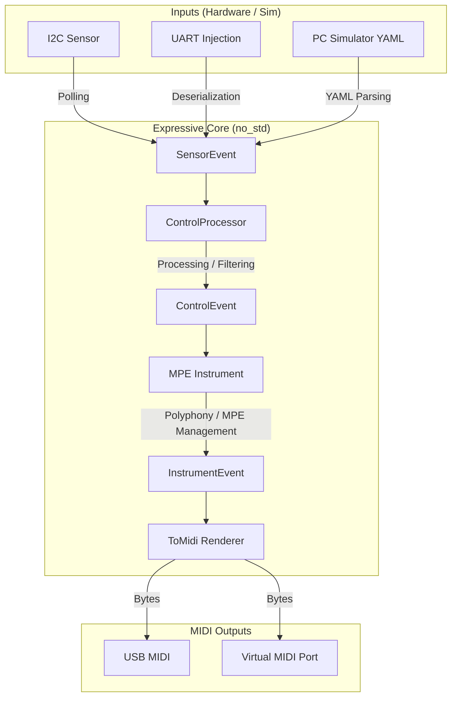

# Architecture

This document details the software and hardware architecture of the **Expressive Control** project.

## 1. Hardware Architecture & Deployment

The system can be deployed in three different configurations to facilitate development, testing, and final use.

```mermaid
flowchart TD
    subgraph PCSim["💻 100% PC Simulation"]
        YAML[scenario.yml] -->|Reads| PC_SIM[PC Simulator]
        PC_SIM -- "Virtual MIDI Port" --> DAW3[DAW / Synth]
    end

    subgraph HIL["🛠️ Hardware-In-the-Loop (HIL)"]
        PC[PC Simulator] -- "UART (Postcard/COBS)" --> NRF_HIL[nRF5340]
        NRF_HIL -- "USB MIDI" --> DAW1[DAW / Synth]
    end

    subgraph Standalone["🎸 Standalone (Production)"]
        SENSOR[I2C Sensor] -- "I2C" --> NRF_STD[nRF5340]
        NRF_STD -- "USB MIDI" --> DAW2[DAW / Synth]
    end
```

## 2. Software Architecture (Core)

The core of the system (`expressive-core`) is hardware-agnostic (`no_std`). It handles processing raw sensor events and transforming them into MPE MIDI events.

### Processing Pipeline

1. **Inputs**: Sensor events come either from a hardware read (`I2C`) or an injection (`UART` for HIL, YAML for `PC Simulator`).
2. **ControlProcessor**: Interprets raw sensor data (`SensorEvent`) and converts them into abstract control parameters (`ControlEvent`, e.g., pressure, X/Y position).
3. **MPE Instrument**: Manages polyphonic logic, MPE channel allocation (Note-per-channel), and note lifecycles (`InstrumentEvent`).
4. **Renderer (`ToMidi`)**: Serializes musical events into standard MIDI bytes.
5. **Transport / Outputs**: These bytes are sent via the available hardware protocol (USB on the nRF5340, virtual port on PC).
